# Sync removal confirmation evidence for #825

All captures use synthetic browser fixtures: no personal data, credentials or live relay responses.
Both prompts retain the reported invalid-snapshot error. The fixture uses a remembered key;
opening, cancelling and escaping the prompts leaves persisted application state unchanged.

Base: `acec3ef9540d8e8a27f0bdefbcb251a4c4ee7a46`.
Candidate: `c16c2c3d373d38b9e2a708c069bf797d771528c9`.

Before: `SETTINGS_DATA_SCREENSHOT_PHASE=before PLAYWRIGHT_WEB_PORT=4425 bun run verify:browser -- --project=chromium tests/e2e/settings-your-data.spec.ts --workers=1`.
Six cases fail the added width/wrapping/layout assertions against the original component.
After: `PLAYWRIGHT_WEB_PORT=4425 bun run verify:browser -- --project=chromium tests/e2e/settings-your-data.spec.ts --workers=1`.
Six cases pass, including keyboard focus, Escape, cancellation, unchanged stored state and the existing restore-point checks.
Focused screenshots were captured from the equivalent component before committing. The full local suite was later interrupted as redundant with passing CI; see [validation details](VALIDATION.md).

The JSON files retain measured card, panel, text and button bounds. At 1440px, the original
Delete panel is 115.5px wide with five text lines; the fixed panel is 1022px wide with one text line.
At 320px the fixed buttons stack at their natural width with an 8px gap.

## 1440px, light

| State | Before | After |
| --- | --- | --- |
| unpair | 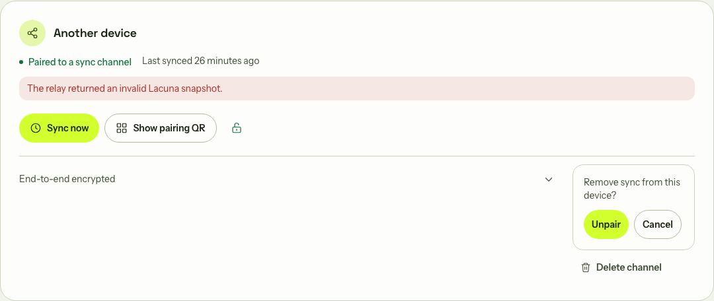 | 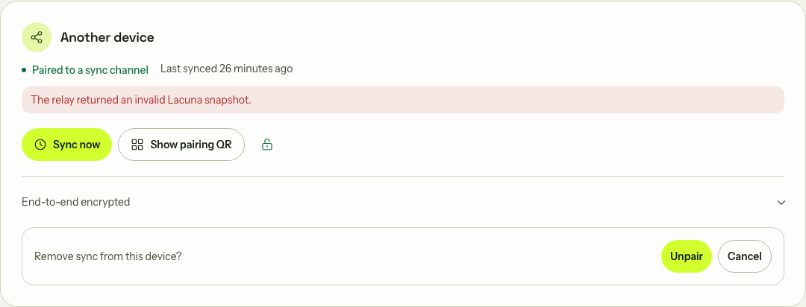 |
| delete | 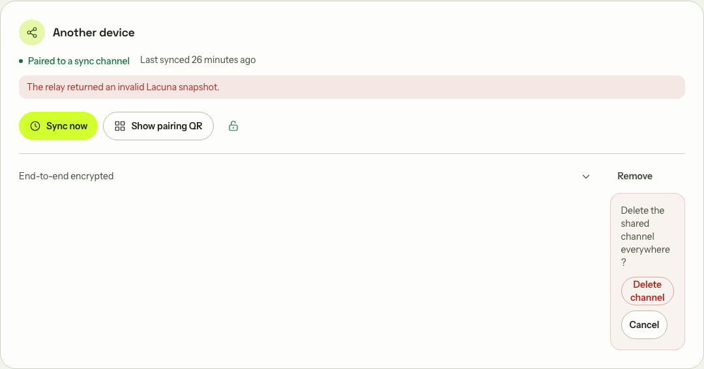 | 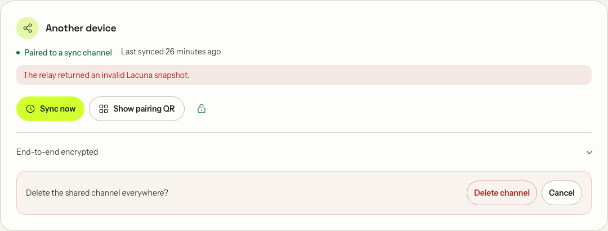 |

## 1440px, dark

| State | Before | After |
| --- | --- | --- |
| unpair | 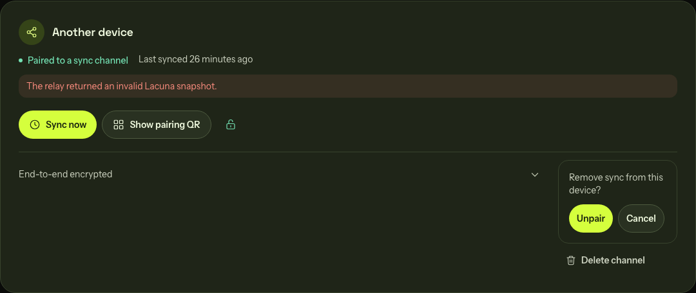 | 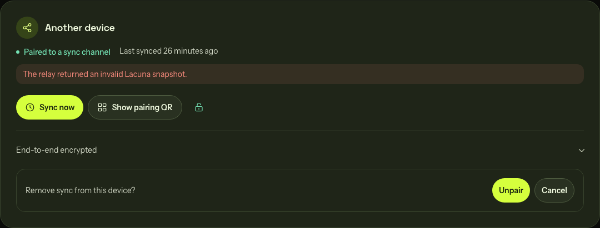 |
| delete | 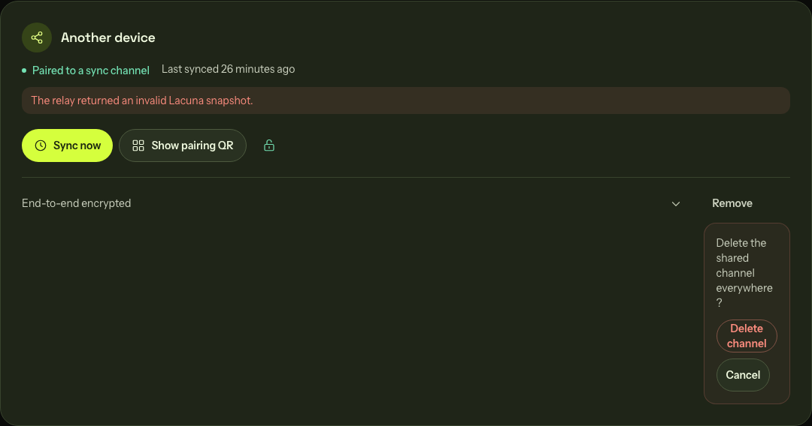 | 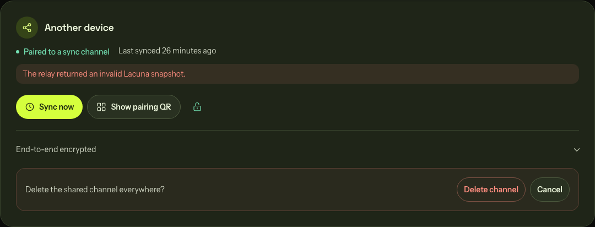 |

## 390px, light

| State | Before | After |
| --- | --- | --- |
| unpair | 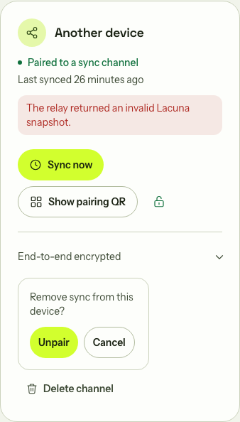 | 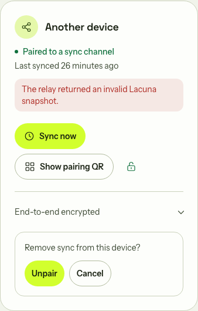 |
| delete | 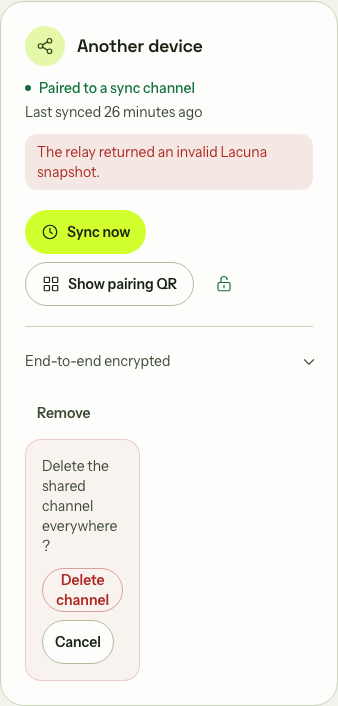 | 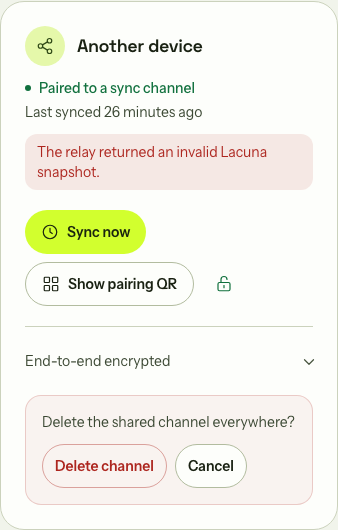 |

## 390px, dark

| State | Before | After |
| --- | --- | --- |
| unpair | 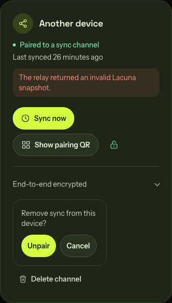 | 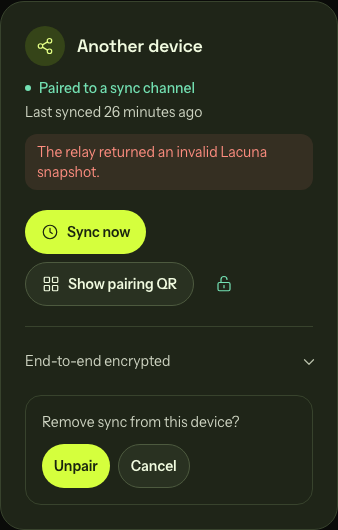 |
| delete | 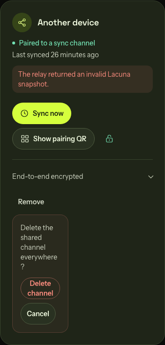 | 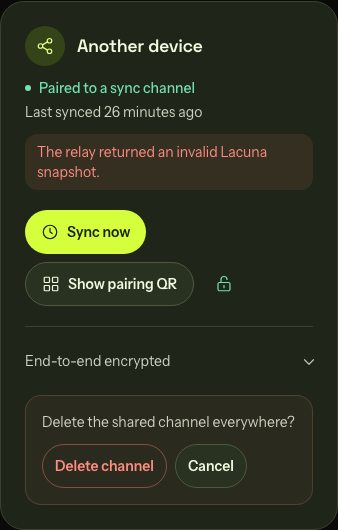 |

## 320px, light

| State | Before | After |
| --- | --- | --- |
| unpair | 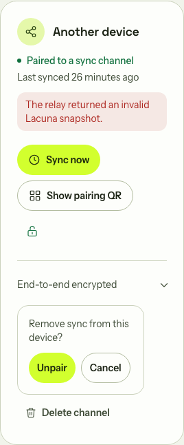 | 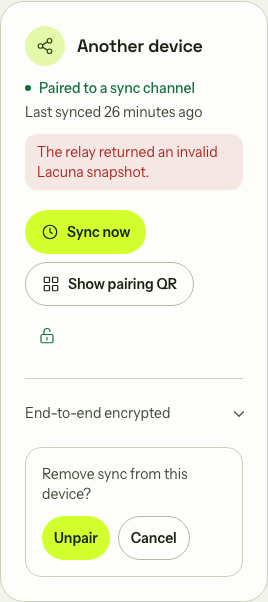 |
| delete | 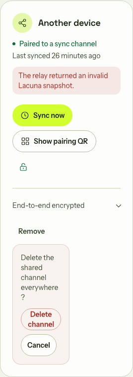 | 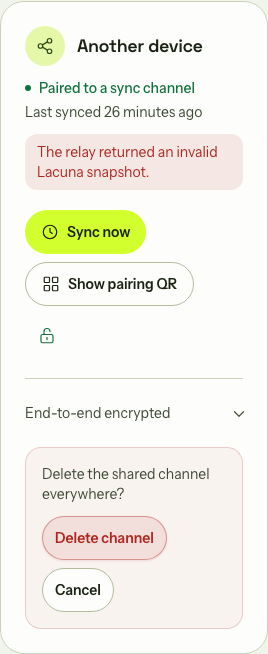 |

## 320px, dark

| State | Before | After |
| --- | --- | --- |
| unpair | 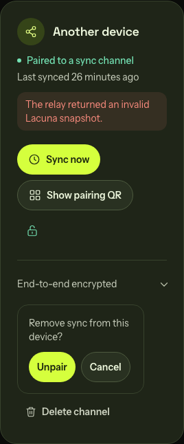 | 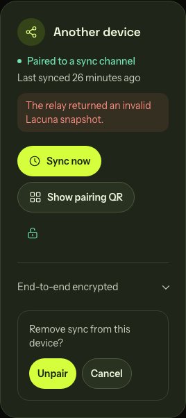 |
| delete | 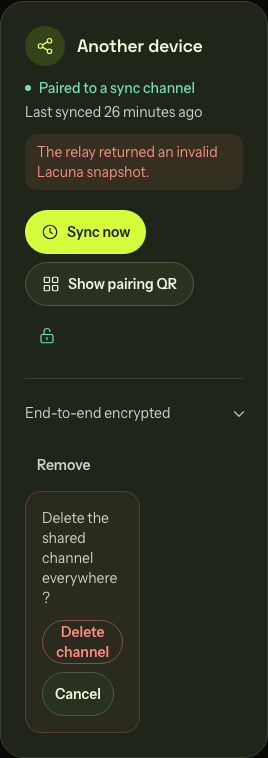 | 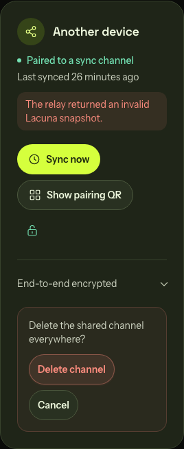 |

