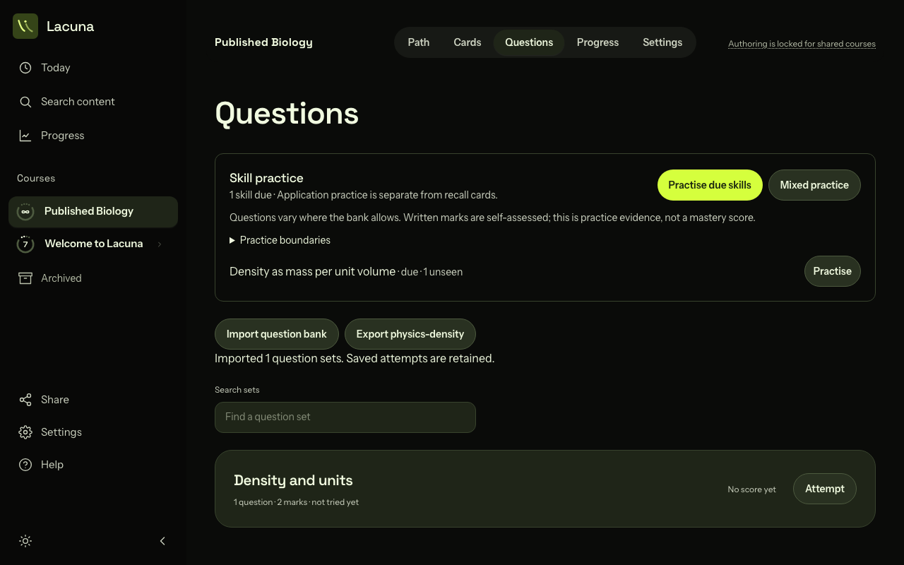
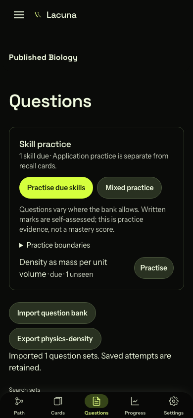

# Locked-course Question bank import

These captures use a synthetic published Biology course and the public
`static-multipart.json` Question bank. They show the learner view with bank import and export
available while question-set authoring remains locked.

Browser command: `PLAYWRIGHT_WEB_PORT=4381 bun run verify:browser -- --project=chromium concept-practice.spec.ts`.
